# Practical NLP — a hands-on course in classical natural language processing

[](https://github.com/hentablihamza/practical-nlp-course/actions/workflows/ci.yml)
[](https://colab.research.google.com/github/hentablihamza/practical-nlp-course/blob/main/notebooks/01_intro_and_text_basics.ipynb)


A practical, notebook-first course that takes you from raw text to a working text
classifier, one idea at a time. You learn how to clean text, how to turn words and
documents into numbers — from one-hot vectors and Bag-of-Words, through term frequency and
TF-IDF, to word2vec and GloVe embeddings — and how to train and evaluate classic
machine-learning models on text.

Every notebook runs on real English documents (20 Newsgroups, the SMS Spam Collection),
every output is produced by executed code, and every notebook opens in Google Colab with
one click.

## Who it is for

- Master's and advanced undergraduate students taking a first NLP course
- Data scientists who use `TfidfVectorizer` daily and want to know what it really does
- Scientists from other fields (chemistry, biology, …) who want solid text-mining basics
- Anyone preparing to study transformers who wants the classical foundations first

You need basic Python and a little NumPy/pandas. No prior NLP is assumed.

## The course arc

```
raw text ─► preprocessing ─► sparse representations ─► dense representations ─► classic ML
            tokens, stems,    one-hot, Bag-of-Words,    word2vec, GloVe           Naive Bayes,
            lemmas, regex     TF / TF-IDF, n-grams,                               Logistic Regression,
                              LSA                                                 SVM + evaluation
```

The course **stops at classic machine learning on text**. Neural sequence models and
attention/transformers are deliberately out of scope — they are covered step by step in the
companion repo **[attention-explained](https://github.com/hentablihamza/attention-explained)**.

## About this course

This material was used for teaching the NLP course to **Master 1 (M1) students at the
University of Médéa, 2022–2023**. It has been reorganised into self-contained, executable
Jupyter notebooks so that anyone can follow it on their own.

## Notebooks

| # | Notebook | Topics | Status |
|---|---|---|---|
| 01 | [Intro and text basics](notebooks/01_intro_and_text_basics.ipynb) [](https://colab.research.google.com/github/hentablihamza/practical-nlp-course/blob/main/notebooks/01_intro_and_text_basics.ipynb) | what NLP is, corpora, documents, tokens, the NLP pipeline, a first look at the data | ✅ |
| 02 | [Text preprocessing](notebooks/02_text_preprocessing.ipynb) [](https://colab.research.google.com/github/hentablihamza/practical-nlp-course/blob/main/notebooks/02_text_preprocessing.ipynb) | tokenization, lowercasing, stopwords, stemming vs lemmatization, regex cleaning, a reusable `preprocess()` | ✅ |
| 03 | [One-hot and Bag-of-Words](notebooks/03_one_hot_and_bag_of_words.ipynb) [](https://colab.research.google.com/github/hentablihamza/practical-nlp-course/blob/main/notebooks/03_one_hot_and_bag_of_words.ipynb) | one-hot encoding, vocabulary, `CountVectorizer`, sparsity, limitations | ✅ |
| 04 | [Term weighting: TF and TF-IDF](notebooks/04_tf_and_tfidf.ipynb) [](https://colab.research.google.com/github/hentablihamza/practical-nlp-course/blob/main/notebooks/04_tf_and_tfidf.ipynb) | raw counts → TF → IDF → TF-IDF, by hand and checked against scikit-learn | ✅ |
| 05 | [N-grams and language intuition](notebooks/05_ngrams.ipynb) [](https://colab.research.google.com/github/hentablihamza/practical-nlp-course/blob/main/notebooks/05_ngrams.ipynb) | bigrams/trigrams, collocations (PMI), sparsity trade-off, a simple bigram language model | ✅ |
| 06 | [Document similarity](notebooks/06_document_similarity.ipynb) [](https://colab.research.google.com/github/hentablihamza/practical-nlp-course/blob/main/notebooks/06_document_similarity.ipynb) | Euclidean vs Jaccard vs cosine, nearest-document search, precision@10, similarity heatmaps | ✅ |
| 07 | [Dimensionality reduction and topics](notebooks/07_topic_models_lsa_lda.ipynb) [](https://colab.research.google.com/github/hentablihamza/practical-nlp-course/blob/main/notebooks/07_topic_models_lsa_lda.ipynb) | LSA (truncated SVD on TF-IDF), LDA topic models, topics vs real categories | ✅ |
| 08 | [Distributional semantics and word2vec](notebooks/08_word2vec.ipynb) [](https://colab.research.google.com/github/hentablihamza/practical-nlp-course/blob/main/notebooks/08_word2vec.ipynb) | CBOW vs skip-gram, training word2vec offline with gensim, neighbours, analogies, PCA/t-SNE | ✅ |
| 09 | [GloVe and pretrained embeddings](notebooks/09_glove_and_pretrained.ipynb) [](https://colab.research.google.com/github/hentablihamza/practical-nlp-course/blob/main/notebooks/09_glove_and_pretrained.ipynb) | co-occurrence matrices, GloVe from scratch in NumPy, PPMI + SVD, pretrained vectors and coverage | ✅ |
| 10 | [Text classification with classic ML](notebooks/10_text_classification_classic_ml.ipynb) [](https://colab.research.google.com/github/hentablihamza/practical-nlp-course/blob/main/notebooks/10_text_classification_classic_ml.ipynb) | Naive Bayes, Logistic Regression and Linear SVM on BoW / TF-IDF / n-grams / averaged word2vec, confusion matrix, most informative words | ✅ |
| 11 | [Evaluation and pitfalls](notebooks/11_evaluation_and_pitfalls.ipynb) [](https://colab.research.google.com/github/hentablihamza/practical-nlp-course/blob/main/notebooks/11_evaluation_and_pitfalls.ipynb) | accuracy paradox, precision/recall/F1, macro vs micro, PR curves and thresholds, class imbalance, cross-validation, data leakage, duplicates | ✅ |
| 12 | [Mini project and recap](notebooks/12_mini_project_and_recap.ipynb) [](https://colab.research.google.com/github/hentablihamza/practical-nlp-course/blob/main/notebooks/12_mini_project_and_recap.ipynb) | an end-to-end SMS spam filter (word + char TF-IDF pipeline, CV model selection, one-shot test, error analysis, saved model) + a recap of the whole course | ✅ |

Each notebook has learning objectives, explanations in markdown, executed code with real
outputs, and exercises with collapsible solutions.

## A taste of the figures

Every figure is generated by the notebooks from the real data (see [`docs/`](docs/)).

| | |
|---|---|
| 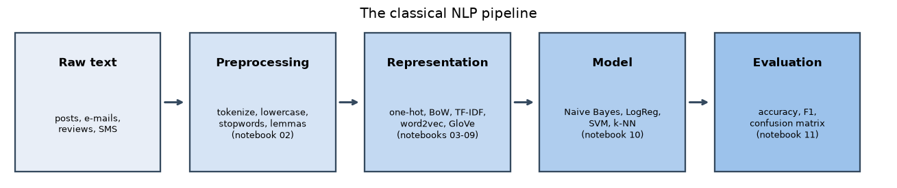 | 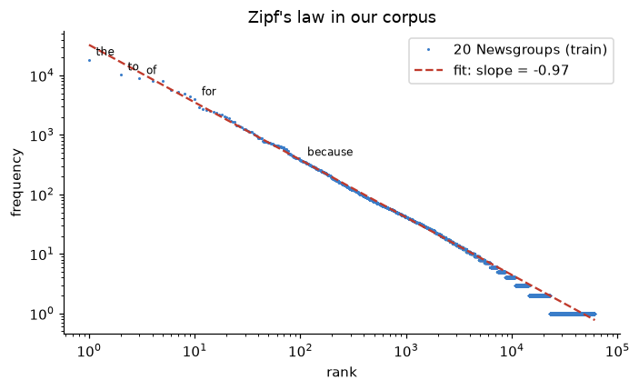 |
| 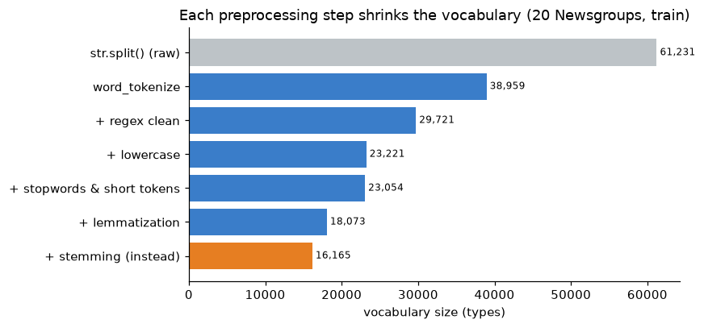 | 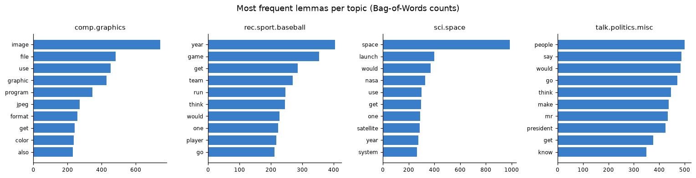 |
| 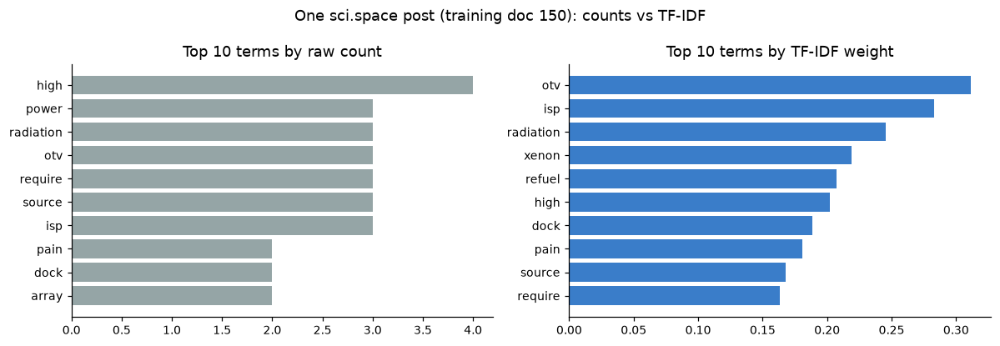 | 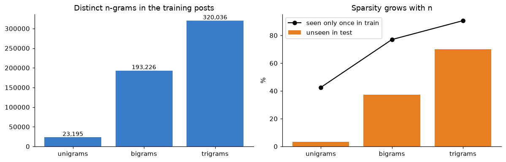 |
| 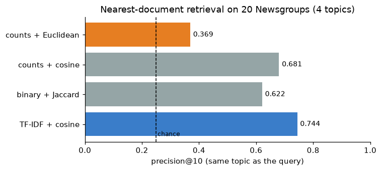 | 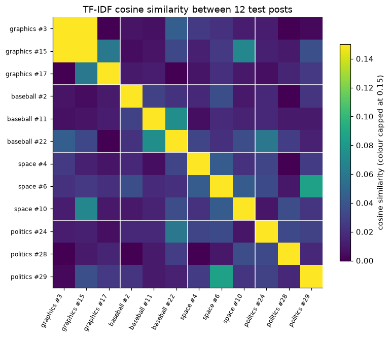 |
| 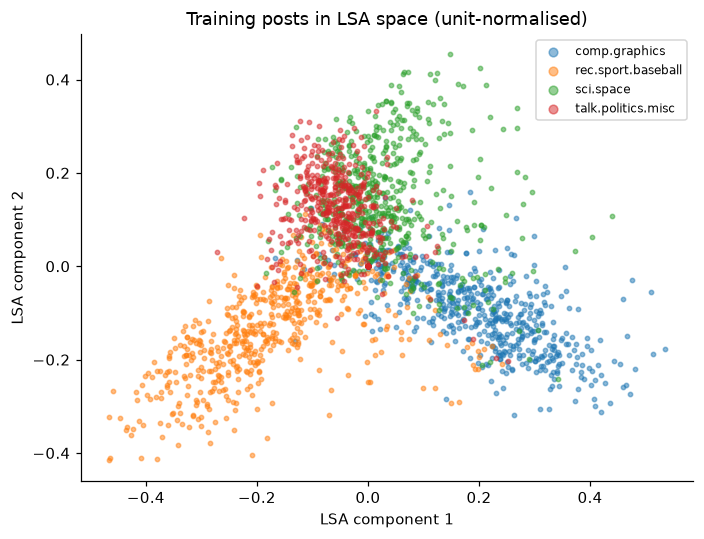 | 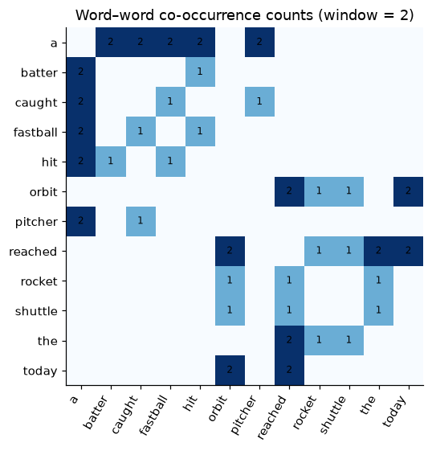 |
| 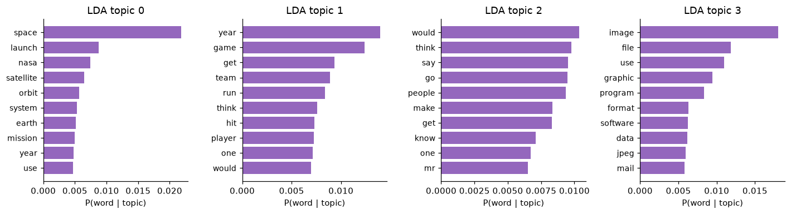 | 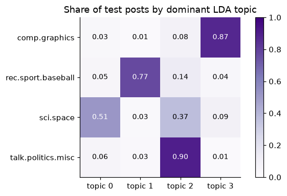 |
| 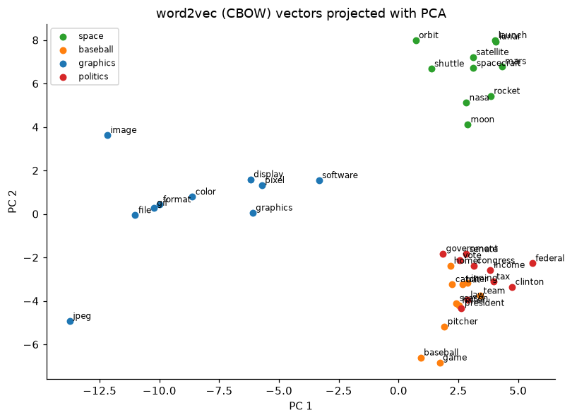 | 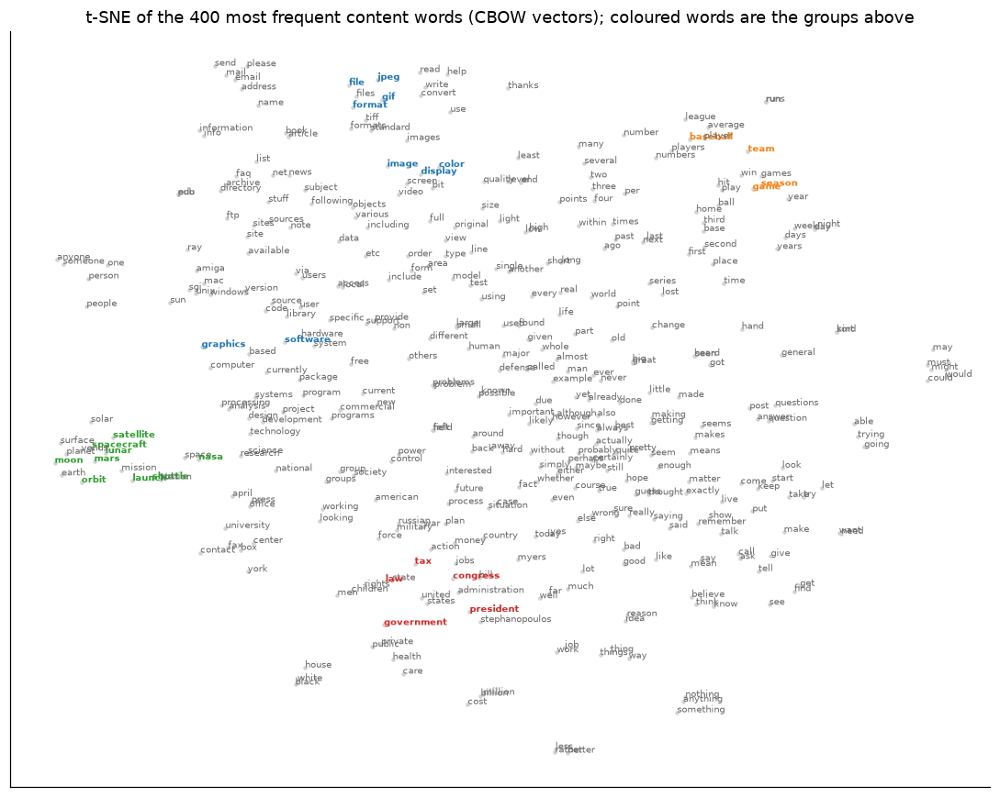 |
| 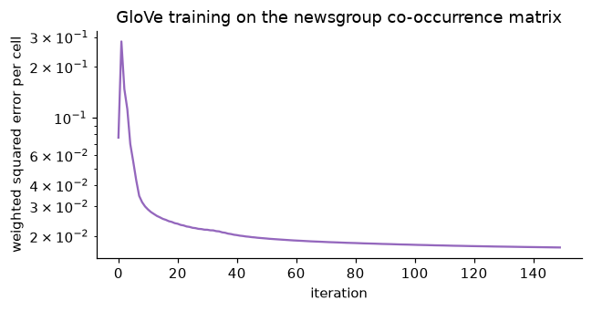 | 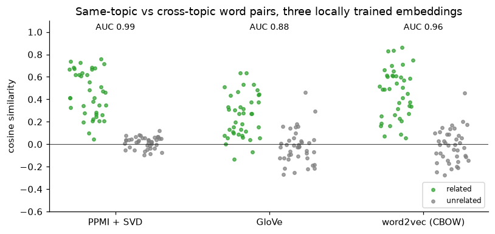 |
| 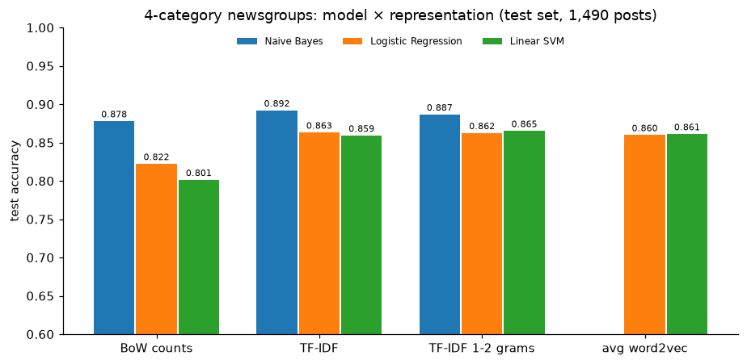 | 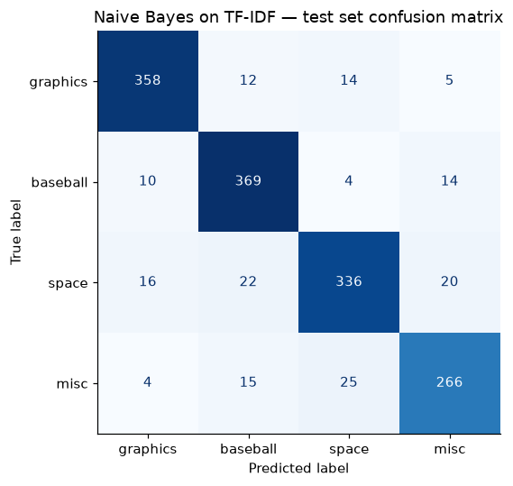 |
| 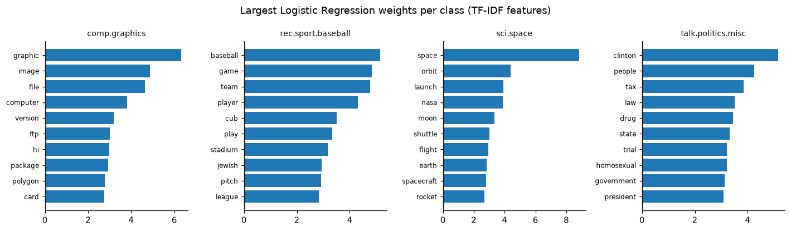 | 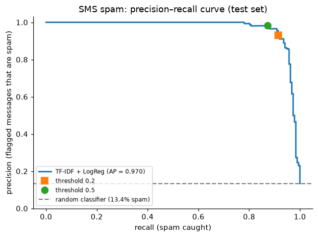 |
| 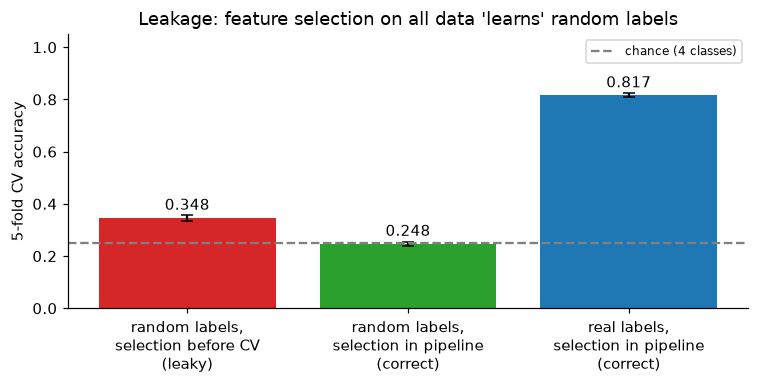 | 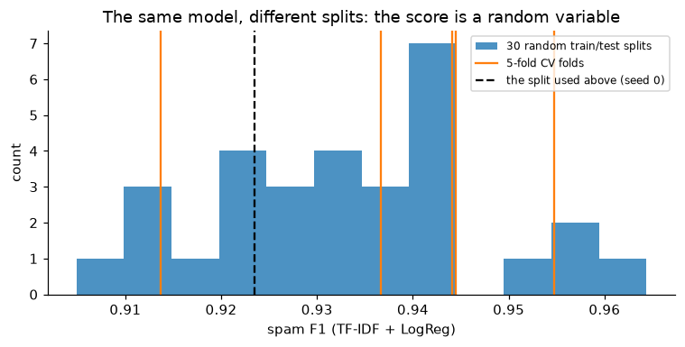 |
| 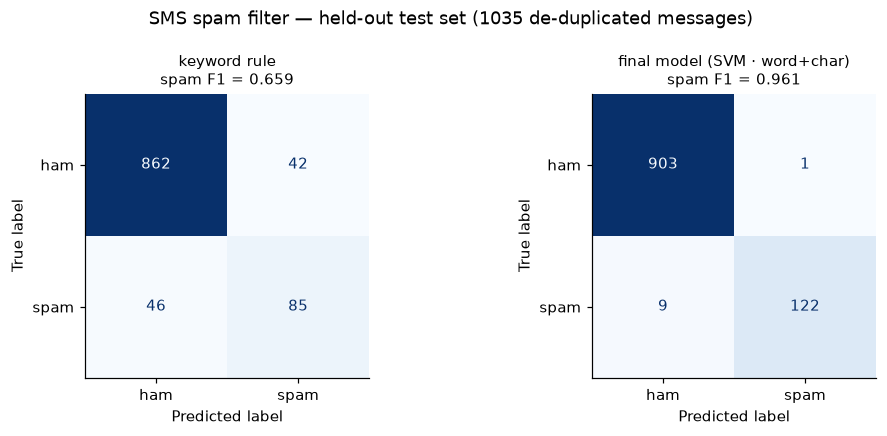 | 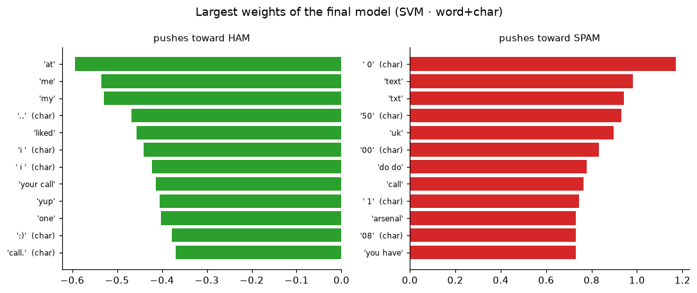 |

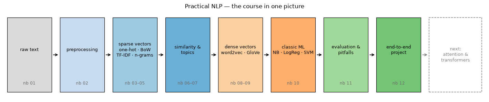

## Data

All data is cached in [`data/`](data/) so the notebooks run offline — see
[`data/README.md`](data/README.md) for sources, counts and attribution.

- **20 Newsgroups** (4 categories: baseball, space, computer graphics, politics) — 3,729 posts
- **SMS Spam Collection** — 5,574 text messages
- **NLTK resources** — tokenizer, English stopwords, WordNet

## How to run

**Google Colab (no install).** Click a Colab badge above. The first cell of every notebook
installs what is missing and fetches the course data automatically.

**Locally.**

```bash
git clone https://github.com/hentablihamza/practical-nlp-course.git
cd practical-nlp-course
python -m venv .venv && source .venv/bin/activate   # or: conda env create -f environment.yml
pip install -r requirements.txt
jupyter lab notebooks/
```

To run fully offline (as CI does): `export NLP_OFFLINE=1`.

## Continuous integration

On every push, GitHub Actions executes **every** notebook from top to bottom on Python 3.10
and 3.11 with `NLP_OFFLINE=1`, so the outputs you see are reproducible from the cached data.

## Author

**Hamza Hentabli**
- Google Scholar: https://scholar.google.com/citations?user=-7dUlnMAAAAJ
- ORCID: [0000-0002-9530-2815](https://orcid.org/0000-0002-9530-2815)

### Related repositories

- [attention-explained](https://github.com/hentablihamza/attention-explained) — the attention mechanism and transformers, step by step (the natural next course)
- [practical-cheminformatics-course](https://github.com/hentablihamza/practical-cheminformatics-course) — hands-on cheminformatics with RDKit
- [fingerprint-similarity-guide](https://github.com/hentablihamza/fingerprint-similarity-guide) — which molecular fingerprint and similarity metric to use, backed by benchmarks
- [chembl-easy](https://github.com/hentablihamza/chembl-easy) — getting bioactivity data out of ChEMBL
- [docking-made-easy](https://github.com/hentablihamza/docking-made-easy) — molecular docking, step by step
- [schrodinger-hpc](https://github.com/hentablihamza/schrodinger-hpc) — running Schrödinger on an HPC cluster with SLURM
- [gnn-for-molecules](https://github.com/hentablihamza/gnn-for-molecules) — graph neural networks for molecules

## Citation

If you use this course, please cite it via [`CITATION.cff`](CITATION.cff) (GitHub's
"Cite this repository" button).
